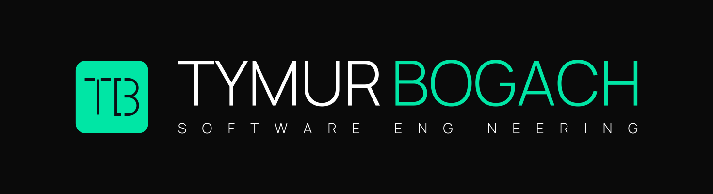

<p align="center">
  <a href="https://nastymur.com">
    <picture>
      <source media="(prefers-color-scheme: light)" srcset="assets/banner-light.png">
      
    </picture>
  </a>
</p>

<p align="center">
  <a href="mailto:tymurbogach@gmail.com"></a>
  
</p>

<p align="center">
  <a href="https://nastymur.com"><b>Portfolio</b></a> ·
  <a href="https://nastymur.com/TymurBogach_CV_EN.pdf"><b>CV (EN)</b></a> ·
  <a href="https://nastymur.com/TymurBogach_CV_ES.pdf"><b>CV (ES)</b></a> ·
  <a href="https://www.linkedin.com/in/tymur-bogach/"><b>LinkedIn</b></a> ·
  <a href="mailto:tymurbogach@gmail.com"><b>Email</b></a>
</p>

<p align="center">
  
</p>

## About

I spent more than ten years fixing and repainting vehicles by hand. Now I build software with the same habits:
diagnose first, do the work properly, and hand it over finished. I build web applications end to end,
from the database schema to the container in production, and I run the infrastructure they live on.

- **Builds:** Laravel + Angular products, Python / FastAPI services, Astro sites.
- **Operates:** a two-node homelab with ~50 Docker containers, deploys from Git, monitoring.
- **Tools:** Linux desktop widgets and themes for [Omarchy](https://omarchy.org) (QML, Bash, Python).
- **Languages:** Russian · Ukrainian (native) · Spanish (fluent) · English (intermediate).
- **Education:** CFGS Web Application Development (2023–2025) · Certified Scrum Developer (2026).

## Featured projects

| Project | What it is | Stack |
|---|---|---|
| **[LazyTripZ](https://github.com/tymurbogach/LazyTripZ)** · [live](https://lazytripz.nastymur.com) | Multi-destination trip planner with shared trips, per-trip roles, pets, weather and a diary. Recommendations come from Gemini through async jobs. | Laravel 13 · Angular 21 · MariaDB · OAuth2 · Docker |
| **[Portfolio](https://github.com/tymurbogach/Portfolio)** · [live](https://nastymur.com) | My site, an interactive CV and a chat widget backed by local Ollama inference. Themed in seven palettes, visual regression tests, self-hosted analytics. | Astro · TypeScript · Tailwind · Docker |
| **[ragmur](https://github.com/tymurbogach/ragmur)** | Prototype of a multi-tenant retrieval service with per-client data separation, API keys and tenant isolation. | FastAPI · SQLAlchemy · PostgreSQL · Qdrant |

## Open source: desktop tools for Omarchy

| Tool | What it does |
|---|---|
| [Enter the Matrix](https://github.com/tymurbogach/omarchy-enter-the-matrix-theme) | Complete Matrix theme: digital rain, lock screen, screensaver, boot splash |
| [replicant](https://github.com/tymurbogach/replicant) | Save and restore an Omarchy setup across machines |
| [hardwarchy](https://github.com/tymurbogach/hardwarchy) | Modular hardware read-out for CPU, GPU, memory, disks and fans |
| [sleepwalker](https://github.com/tymurbogach/omarchy-sleepwalker) | Suspend and lid control from the bar |
| [battery](https://github.com/tymurbogach/battery) | Power profiles, charge limit and consumption history |
| [agents](https://github.com/tymurbogach/agents) | Usage widget for AI coding agents with pluggable collectors |

## The homelab behind it

```text
TrueNAS SCALE (ZFS) · Raspberry Pi 5
~50 containers · Tailscale + Cloudflare tunnels
```

Reverse proxy, monitoring, local LLM inference (Ollama), private search (SearXNG), media and photo services,
and deploy scripts, all kept in one Git repository. LazyTripZ and my portfolio run on it today.

## Stack

<p>
  <br>
  <br>
  
</p>

## Path

- **2026** · Certified Scrum Developer. Building LazyTripZ, ragmur and the Omarchy tools in the open.
- **2025** · Development intern at GesinFlot by TDI (Murcia): Android fleet-management app in Java, REST integration, APK delivery.
- **2023–2025** · CFGS in Web Application Development (HTML, CSS, JavaScript, TypeScript, PHP, Java, SQL, Angular, Laravel, Docker).
- **2012–2024** · Body and paint technician: structural repair, welding, finishing and delivery of vehicles.

## Let's talk

I'm looking for a full-stack or backend role where I can own features from schema to production.
The quickest way to reach me is email. My CV is one click away above.

<p align="center">
  <a href="mailto:tymurbogach@gmail.com"></a>
  <a href="https://www.linkedin.com/in/tymur-bogach/"></a>
  <a href="https://nastymur.com"></a>
</p>
